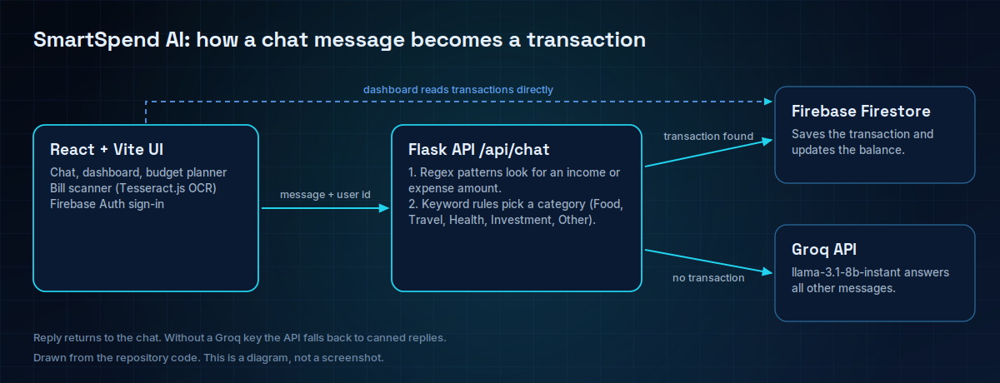
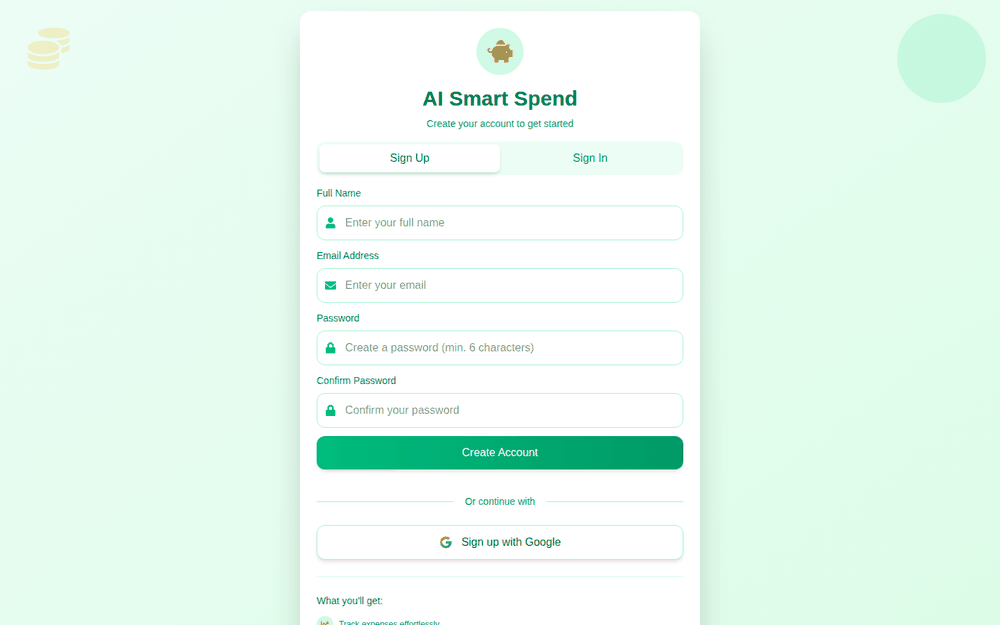
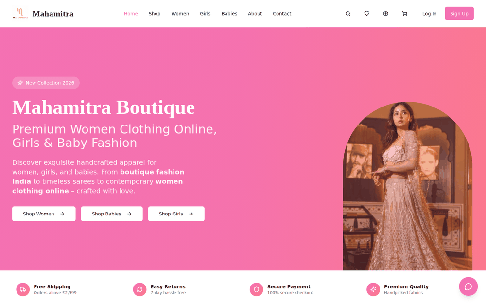
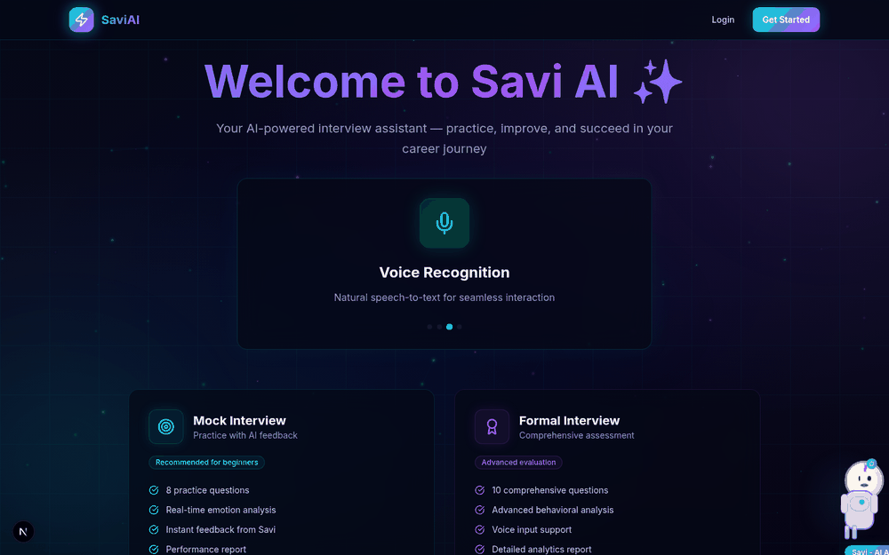
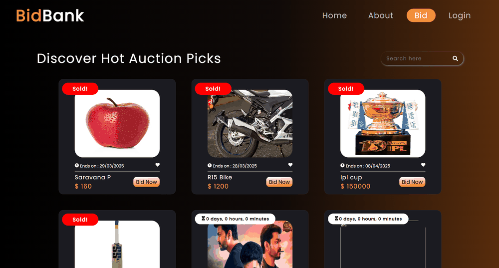

 

<a href="https://saravana-p.me">Portfolio</a> &nbsp;·&nbsp;
<a href="https://www.linkedin.com/in/saravana-p-kec">LinkedIn</a> &nbsp;·&nbsp;
<a href="https://github.com/saravana-31">GitHub</a> &nbsp;·&nbsp;
<a href="https://leetcode.com/u/Saravana_P/">LeetCode</a>

  

 

## About

I build AI-powered applications end to end. In **SmartSpend AI** that is a chat assistant backed by a Flask API and Firebase. In the **Intelligence Extraction Agent** it is a FastAPI pipeline that tries rules before it asks an LLM. In **SaviAI** it is an interview-practice app wired to local models.

I'm a final-year B.Tech Artificial Intelligence and Machine Learning student at **Kongu Engineering College** (graduating 2027), based in Tamil Nadu, India.

The problems I like are the ones where a model is one part of a larger system: deciding when ordinary code is enough, what happens when the model isn't available, and how the result reaches a person through an interface they can use. I label prototypes as prototypes and credit team work as team work.

---

## Engineering focus

 

<table>
<tr>
<td width="50%" valign="top">

**AI-powered applications and LLM integration**

Groq-hosted Llama in SmartSpend AI, Ollama behind the Intelligence Agent, local `llama.cpp` models in SaviAI. Rules come first where they are reliable, and the app degrades gracefully when no model key is configured.

</td>
<td width="50%" valign="top">

**Backend services and data workflows**

Flask, FastAPI and Express APIs. Deterministic parsing and validation (Pydantic schemas in the Intelligence Agent, bid rules in BidBank) with Firebase, MongoDB and Supabase for persistence.

</td>
</tr>
<tr>
<td width="50%" valign="top">

**Full-stack product development**

React and Next.js interfaces over those APIs: sign-in flows, dashboards, listing and bidding screens, and storefront, payment and admin screens in my Mahamitra contribution.

</td>
<td width="50%" valign="top">

**Applied machine learning**

CNN image classification (Deception Detection) and fraud detection with logistic regression, random forest and SMOTE (Credit Card Fraud Detection), kept as notebook experiments.

</td>
</tr>
</table>

---

## Featured projects

Screenshots below come from local runs of the public repositories (or from the project's own README) with external services not connected, so data-driven screens are empty or gated. Diagrams are labelled as diagrams.

 

### 1. SmartSpend AI

**Conversational expense tracking** &nbsp;|&nbsp; Working prototype &nbsp;|&nbsp; Team project

**Problem.** Logging every expense by hand is the step people skip.

**Approach.** Type a message such as an amount and what it was for. A Flask API matches amount patterns, assigns a keyword-based category (Food, Travel, Health, Investment, Other), and writes the transaction to Firestore. Messages that aren't transactions go to a Groq-hosted Llama 3.1 model.

**Also in the app.** Dashboard, budget planner, calculators, and an OCR bill scanner built on Tesseract.js.

**Current limits.** Intent detection is pattern-based, so unusual phrasing is missed. It needs your own Firebase project and Groq key, the front end calls the API at `localhost:5000`, and there are no automated tests. No live demo is linked because I haven't verified one.

`React` `Vite` `Flask` `Groq` `Firebase`

[**Repository**](https://github.com/Saravana-31/Smart-Spend) &nbsp;|&nbsp; [Earlier Next.js iteration](https://github.com/Saravana-31/Smart_Spend)

Sign-up screen from a local run. Every other page sits behind Firebase sign-in, so the chat and dashboard are not shown here.

**Two versions, on purpose.** [`Smart-Spend`](https://github.com/Saravana-31/Smart-Spend) is the current Vite and React app with the Flask API above. [`Smart_Spend`](https://github.com/Saravana-31/Smart_Spend) is the earlier Next.js "SmartSpend+" iteration, whose Flask endpoint returns a placeholder reply instead of calling a model. The repository history shows other contributors alongside me.

<!-- TODO (Saravana): add one line naming exactly which parts of SmartSpend AI you built, e.g. "I built the Flask API and the chat page." -->

 

### 2. Mahamitra

**E-commerce platform** &nbsp;|&nbsp; **Team contribution** &nbsp;|&nbsp; Repository owned by Sanjay N at Neovate

Storefront home page from a local run of the public repository. Product data comes from Supabase, which wasn't connected.

**What it is.** A boutique storefront with shopping, orders, wallet top-up and favorites, plus an admin area for dashboard, inventory, coupons, orders and analytics. Payments go through Razorpay, and a shopping assistant runs on Groq behind a Supabase Edge Function.

**My part.** Feature development and testing, as credited in the project README. 15 of the repository's 90 commits are under my GitHub account; most of the rest are Sanjay N's. I don't own this codebase.

`React` `TypeScript` `Supabase` `Razorpay` `Groq`

[**Original repository**](https://github.com/sanjayn29/Mahamitra-E-commence)

<!-- TODO (Saravana): name the specific Mahamitra features you built or tested (for example a checkout, wallet or admin screen). -->

 

### 3. SaviAI

**AI interview preparation** &nbsp;|&nbsp; Prototype

Home page from a local run (no database connected).

**What it does.** Aptitude practice, coding practice in several languages, and AI mock interviews with speech input, a live face-detection preview for emotion feedback, evaluation, history and reports.

**Architecture.** Next.js and TypeScript with NextAuth and MongoDB. Question generation is designed for local models (Mistral 7B and CodeLlama through `llama.cpp`).

**To run it.** Download the model files named in the repository README (roughly 4 GB each); Docker Compose files are included. Not production-ready.

`Next.js` `TypeScript` `MongoDB` `NextAuth` `llama.cpp`

[**Repository**](https://github.com/Saravana-31/Savi_AI)

 

### 4. BidBank

**Online auction platform** &nbsp;|&nbsp; Full-stack prototype

Auction listings, from the screenshots in the project's own README.

**What it does.** Sign-up and login with hashed passwords and MongoDB-backed sessions, item listings with images and an end date, bids the API validates (must beat the highest bid, meet the starting price and arrive before the end date), countdown timers and a bid-activity feed.

**Be precise.** Socket.IO live updates were started but are commented out, so the app does not push real-time updates. The data model has no user roles, and there is no payment code. No live demo is linked because I haven't verified one.

`React` `Express` `MongoDB` `Node.js`

[**Repository**](https://github.com/Saravana-31/online-auction-platform)

 

### More projects

| Project | What it is | Stack | Status |
|:--|:--|:--|:--|
| [**Intelligence Extraction Agent**](https://github.com/Saravana-31/Autonomous-Intel-Agent) | Extracts contacts, services and certifications from offline website snapshots: rule-based parsing first, then an Ollama-served LLM to classify and normalize, plus a knowledge-graph pipeline and React view. Runs locally. | `FastAPI` `Pydantic` `Ollama` `React` | Working prototype |
| [**PM Internship Recommender**](https://github.com/Saravana-31/SIH_PMIRS) | Skill-first internship matching for Smart India Hackathon problem 25034, with learning-path suggestions when nothing matches and a Groq chat on each listing. Uses sample data. | `React` `Express` `Flask` `Groq` | Hackathon build |
| [**Udyam Registration Portal**](https://github.com/Saravana-31/Udyam_Frontend) ([backend](https://github.com/Saravana-31/Udyam_Backend)) | Two-step registration-flow clone with validation and OTP steps, backed by a TypeScript API with Jest and Supertest tests and a Dockerfile. | `React` `Express` `TypeScript` `Jest` | Self-built |
| [**Form Builder**](https://github.com/Saravana-31/Form_Builder) | MERN form editor with Categorize, Cloze and Comprehension question types, image upload and a fill-in view. | `MongoDB` `Express` `React` `Next.js` | Self-built |
| [**Deception Detection**](https://github.com/Saravana-31/Deception-Detection) | CNN classifier for facial images, with augmentation and a confusion-matrix evaluation. | `TensorFlow` `Keras` | Notebook experiment |
| [**Credit Card Fraud Detection**](https://github.com/Saravana-31/Credit-Card-Fraud-Detection) | Logistic regression and random forest on imbalanced data using SMOTE. | `Python` | Notebook experiment |
| [**Hostel Room Allocation**](https://github.com/Saravana-31/Hostel-Room-Allocation-Application) | Java application for assigning student accommodation. | `Java` | Application |

[Browse all repositories](https://github.com/saravana-31?tab=repositories)

---

## Technical toolkit

<table>
<tr><td width="150"><b>Languages</b></td><td>

</td></tr>
<tr><td><b>AI / ML</b></td><td>

</td></tr>
<tr><td><b>Frontend</b></td><td>

</td></tr>
<tr><td><b>Backend</b></td><td>

</td></tr>
<tr><td><b>Databases</b></td><td>

</td></tr>
<tr><td><b>Testing and tooling</b></td><td>

</td></tr>
</table>

## Experience and education

| | Period |
|:--|:--|
| **Generative AI Internship**, Generative AI Consortium | Mar to Apr 2025 |
| **Software Development Intern**, Codtech IT Solutions | Dec 2024 to Jan 2025 |
| **B.Tech Artificial Intelligence and Machine Learning**, Kongu Engineering College | 2023 to 2027 |

<!-- TODO (Saravana): add one or two factual responsibilities for each internship; none were available to verify. -->

## Certifications

- Oracle Certified Professional: Java SE 17 Developer
- MongoDB Associate Developer
- Oracle APEX Cloud Developer
- NPTEL: Edge Computing
- NPTEL: Affective Computing

<!-- TODO (Saravana): link each certification to its public credential page when available. -->

---

## GitHub activity

 

 

These cards use community-run services and can be rate-limited or briefly unavailable. The language card estimates code composition across public repositories (notebooks and HTML hidden), not proficiency. GitHub's own contribution calendar is on my <a href="https://github.com/saravana-31">profile</a>.

## LeetCode

 

The card depends on a third-party service. If it fails to load, my <a href="https://leetcode.com/u/Saravana_P/">LeetCode profile</a> always shows the current numbers.

---

## Connect

<a href="https://saravana-p.me">Portfolio</a> &nbsp;·&nbsp;
<a href="https://www.linkedin.com/in/saravana-p-kec">LinkedIn</a> &nbsp;·&nbsp;
<a href="https://leetcode.com/u/Saravana_P/">LeetCode</a> &nbsp;·&nbsp;
<a href="https://github.com/saravana-31">GitHub</a>

  

Thanks for reading. The repositories above are the best record of how I work.

