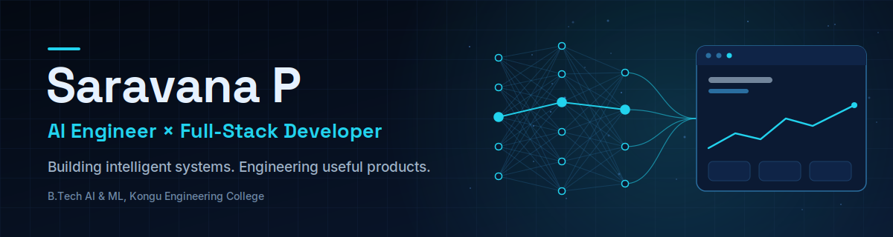
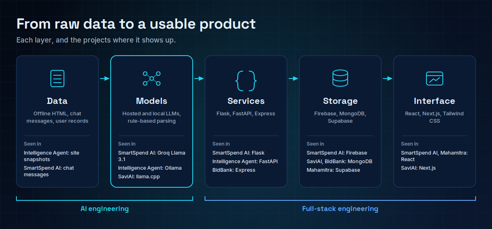
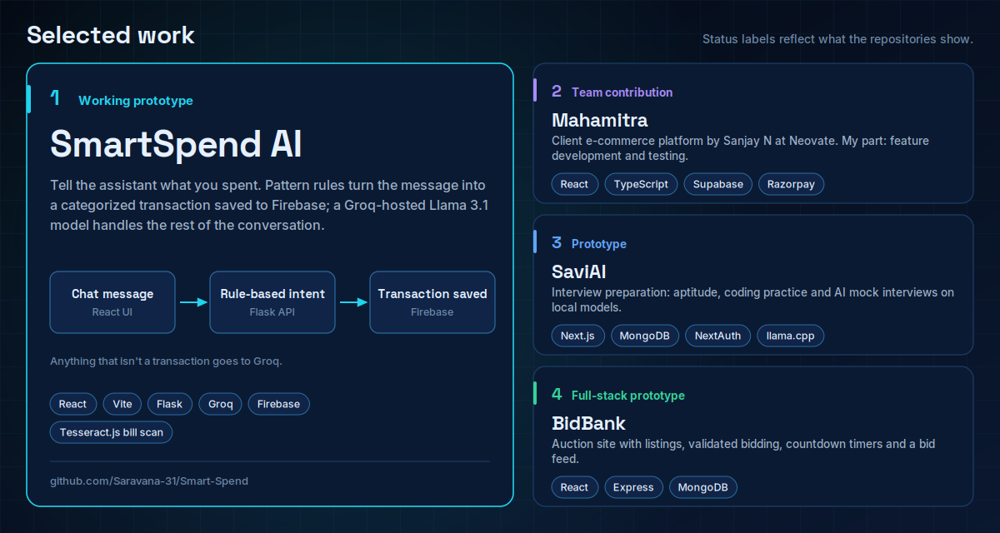

 

<a href="https://saravana-p.me">Portfolio</a> &nbsp;|&nbsp;
<a href="https://www.linkedin.com/in/saravana-p-kec">LinkedIn</a> &nbsp;|&nbsp;
<a href="https://leetcode.com/u/Saravana_P/">LeetCode</a> &nbsp;|&nbsp;
<a href="#featured-projects">Projects</a>

 

I'm a final-year B.Tech Artificial Intelligence and Machine Learning student at **Kongu Engineering College** (graduating 2027), based in Tamil Nadu, India. I build AI-powered applications end to end: the model or LLM call, the API around it, the database behind it, and the interface people actually use.

Most of my work sits where those layers meet: assistants that write structured data, extraction pipelines that combine rules with LLMs, and recommendation tools with a usable front end.

 

## Engineering focus

 

| Area | What I do |
| :-- | :-- |
| **LLM-powered applications** | Integrate hosted and local LLMs (Groq, Ollama) behind APIs, with structured output and fallbacks when a model is unavailable. |
| **Data extraction and recommendation** | Combine deterministic parsing with LLM reasoning; build skill-first matching and knowledge-graph style pipelines. |
| **Full-stack delivery** | React and Next.js front ends, Node/Express, Flask and FastAPI services, MongoDB, Firebase and MySQL. |
| **Applied machine learning** | CNN image classification with TensorFlow/Keras and classical models for imbalanced data, kept in notebooks. |

 

## Featured projects

 

<table>
<tr>
<td width="50%" valign="top">

**SmartSpend AI** (working prototype)

Tracking spending by hand is tedious, so this lets you just tell an assistant. A Flask API pulls expense and income intent out of a chat message and writes it as a categorized transaction to Firebase; a Groq-hosted Llama 3.1 model handles the conversation.

`React 19` `Vite` `Flask` `Groq` `Firebase`

[Repository](https://github.com/Saravana-31/Smart-Spend) | [Earlier Next.js iteration (SmartSpend+)](https://github.com/Saravana-31/Smart_Spend)

</td>
<td width="50%" valign="top">

**Intelligence Extraction Agent** (working prototype)

Company facts are scattered across website pages. This FastAPI service reads offline site snapshots, extracts contacts, services and certifications with rule-based parsing first, then uses an Ollama-served LLM to classify and normalize. It also builds a knowledge graph and serves a React view. Runs locally; no public demo.

`Python` `FastAPI` `Pydantic` `Ollama` `React`

[Repository](https://github.com/Saravana-31/Autonomous-Intel-Agent)

</td>
</tr>
<tr>
<td width="50%" valign="top">

**PM Internship Recommender** (hackathon build)

Built for Smart India Hackathon problem statement 25034. A skill-first recommender (Express engine with a Flask fallback) that suggests learning paths when no listing matches, with a Groq chat on each internship. Runs on sample data, not live scheme listings.

`React` `Node.js` `Express` `Flask` `Groq`

[Repository](https://github.com/Saravana-31/SIH_PMIRS)

</td>
<td width="50%" valign="top">

**SaviAI** (prototype)

Interview preparation in one place: aptitude practice, multi-language coding practice and AI mock interviews. Question generation is designed to run on local models (Mistral 7B and CodeLlama through llama.cpp), so setup needs the model files downloaded.

`Next.js` `TypeScript` `MongoDB` `NextAuth` `llama.cpp`

[Repository](https://github.com/Saravana-31/Savi_AI)

</td>
</tr>
<tr>
<td width="50%" valign="top">

**Mahamitra** (team contribution)

An e-commerce platform built by Sanjay N at Neovate, with Razorpay payments, an admin dashboard and a Groq shopping assistant behind a Supabase Edge Function. The project README credits me with feature development and testing. The repository is owned by Sanjay N.

`React` `TypeScript` `Supabase` `Razorpay`

[Repository](https://github.com/sanjayn29/Mahamitra-E-commence)

</td>
<td width="50%" valign="top">

**Udyam Registration Portal** (self-built)

A clone of the Udyam registration flow for micro and small enterprises: a two-step form with validation and OTP steps, backed by a TypeScript Express API with Jest and Supertest tests and a Dockerfile.

`React` `Express` `TypeScript` `Jest` `Docker`

[Frontend](https://github.com/Saravana-31/Udyam_Frontend) | [Backend](https://github.com/Saravana-31/Udyam_Backend)

</td>
</tr>
</table>

**Also built:**
[BidBank](https://github.com/Saravana-31/online-auction-platform), a MERN auction platform with role-based dashboards and live bidding |
[Form Builder](https://github.com/Saravana-31/Form_Builder), a MERN form editor with Categorize, Cloze and Comprehension questions |
[Deception Detection](https://github.com/Saravana-31/Deception-Detection), a CNN on facial images |
[Credit Card Fraud Detection](https://github.com/Saravana-31/Credit-Card-Fraud-Detection), logistic regression and random forest with SMOTE |
[Hostel Room Allocation](https://github.com/Saravana-31/Hostel-Room-Allocation-Application), in Java.

More running demos and write-ups are on my [portfolio](https://saravana-p.me).

 

## Technical toolkit

| | |
| :-- | :-- |
| **Languages** | `Python` `Java` `JavaScript` `TypeScript` `C` `SQL` |
| **AI and ML** | LLM integration (`Groq`, `Ollama`), prompt-driven assistants, recommendation logic, CNNs with `TensorFlow` / `Keras`, classical ML on imbalanced data |
| **Front end** | `React` `Next.js` `Vite` `Tailwind CSS` |
| **Back end** | `Node.js` `Express` `Flask` `FastAPI` |
| **Data** | `MongoDB` `Firebase` `MySQL` |
| **Tooling** | `Git` `Jest` `Docker` |

 

## Experience and education

| | |
| :-- | :-- |
| **Generative AI Internship**, Generative AI Consortium | Mar to Apr 2025 |
| **Software Development Intern**, Codtech IT Solutions | Dec 2024 to Jan 2025 |
| **B.Tech Artificial Intelligence and Machine Learning**, Kongu Engineering College | 2023 to 2027 |

<!--
CERTIFICATIONS (add once you have credential links, then uncomment):
- Java SE 17 Developer, Oracle University (2026)
- MongoDB Associate Developer, MongoDB Inc. (2025)
- Oracle APEX Cloud Developer, Oracle University (2025)
-->

 

## GitHub activity

 

 

These cards come from community-run services that can be rate-limited or briefly offline. If one doesn't load, the same activity is on my [profile's contribution calendar](https://github.com/saravana-31) and [repository list](https://github.com/saravana-31?tab=repositories). The language card counts bytes of code in public repositories (notebooks and HTML are hidden); it shows what I've committed, not how proficient I am in each language.

 

## LeetCode

Data-structures-and-algorithms practice, mostly in Java. The card is generated live from my public profile; if it doesn't load, [the profile itself](https://leetcode.com/u/Saravana_P/) always shows the current numbers.

 

## Contact

<a href="https://saravana-p.me">Portfolio</a> &nbsp;|&nbsp;
<a href="https://www.linkedin.com/in/saravana-p-kec">LinkedIn</a> &nbsp;|&nbsp;
<a href="https://leetcode.com/u/Saravana_P/">LeetCode</a>

The portfolio has a contact form, which is the best way to reach me.

