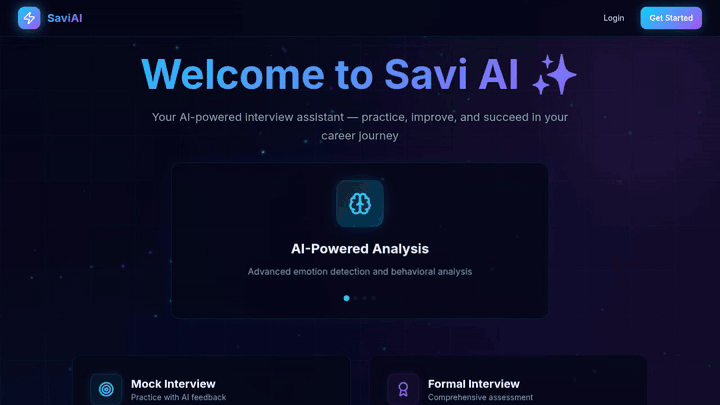

<a href="https://saravana-p.me">Portfolio</a> &nbsp;·&nbsp;
<a href="https://www.linkedin.com/in/saravana-p-kec">LinkedIn</a> &nbsp;·&nbsp;
<a href="https://github.com/Saravana-31">GitHub</a> &nbsp;·&nbsp;
<a href="https://leetcode.com/u/Saravana_P/">LeetCode</a>

 

I'm a final-year B.Tech Artificial Intelligence and Machine Learning student at Kongu Engineering College (2027). I build AI-powered applications end to end: the LLM integration, the API around it, and the interface people use. I label prototypes as prototypes and credit team work as team work.

## Featured projects

### SmartSpend AI

Sign-up screen from a local run; the chat and dashboard sit behind Firebase sign-in.

A chat-based expense tracker: a Flask API picks amounts and categories out of your messages and saves them to Firebase, while a Groq-hosted Llama 3.1 model handles the conversation. Working prototype, built with a team.

`React` `Vite` `Flask` `Groq` `Firebase` &nbsp;·&nbsp; [**Repository**](https://github.com/Saravana-31/Smart-Spend)

### Mahamitra &nbsp;team contribution

A boutique e-commerce platform with Razorpay checkout, an admin dashboard and a Groq shopping assistant. Built by Sanjay N at Neovate; I worked on feature development and testing.

`React` `TypeScript` `Supabase` `Razorpay` &nbsp;·&nbsp; [**Original repository**](https://github.com/sanjayn29/Mahamitra-E-commence)

### SaviAI

An interview-preparation app with aptitude and coding practice and AI mock interviews, designed to run on local models through `llama.cpp`. Prototype.

`Next.js` `TypeScript` `MongoDB` `NextAuth` `llama.cpp` &nbsp;·&nbsp; [**Repository**](https://github.com/Saravana-31/Savi_AI)

### BidBank

An auction platform where users list items, place validated bids and watch countdown timers. Full-stack prototype; live push updates are not enabled.

`React` `Express` `MongoDB` &nbsp;·&nbsp; [**Repository**](https://github.com/Saravana-31/online-auction-platform)

Images are from local runs of the repositories (SaviAI as a recording) or the project's own README (BidBank), with backends not connected.

**More:**
[Intelligence Extraction Agent](https://github.com/Saravana-31/Autonomous-Intel-Agent) ·
[PM Internship Recommender](https://github.com/Saravana-31/SIH_PMIRS) ·
[Udyam Portal](https://github.com/Saravana-31/Udyam_Frontend) ·
[Form Builder](https://github.com/Saravana-31/Form_Builder) ·
[Deception Detection](https://github.com/Saravana-31/Deception-Detection) ·
[Fraud Detection](https://github.com/Saravana-31/Credit-Card-Fraud-Detection) ·
[Hostel Allocation](https://github.com/Saravana-31/Hostel-Room-Allocation-Application)

## Stack

**Languages** `Python` `Java` `JavaScript` `TypeScript` `SQL` 
**AI / ML** `Groq` `Ollama` `llama.cpp` `TensorFlow` `Keras` 
**Web** `React` `Next.js` `Node.js` `Express` `Flask` `FastAPI` `Tailwind CSS` 
**Data and tools** `MongoDB` `Firebase` `Supabase` `MySQL` `Docker` `Git`

## Background

**Internships:** Generative AI Consortium (Mar to Apr 2025), Codtech IT Solutions (Dec 2024 to Jan 2025) 
**Certifications:** Oracle Java SE 17 Developer, MongoDB Associate Developer, Oracle APEX Cloud Developer, NPTEL Edge Computing, NPTEL Affective Computing

## Activity

Cards come from community-run services and can be briefly unavailable. [GitHub profile](https://github.com/Saravana-31) · [LeetCode profile](https://leetcode.com/u/Saravana_P/)

 

<a href="https://saravana-p.me">saravana-p.me</a> &nbsp;·&nbsp;
<a href="https://www.linkedin.com/in/saravana-p-kec">LinkedIn</a>

